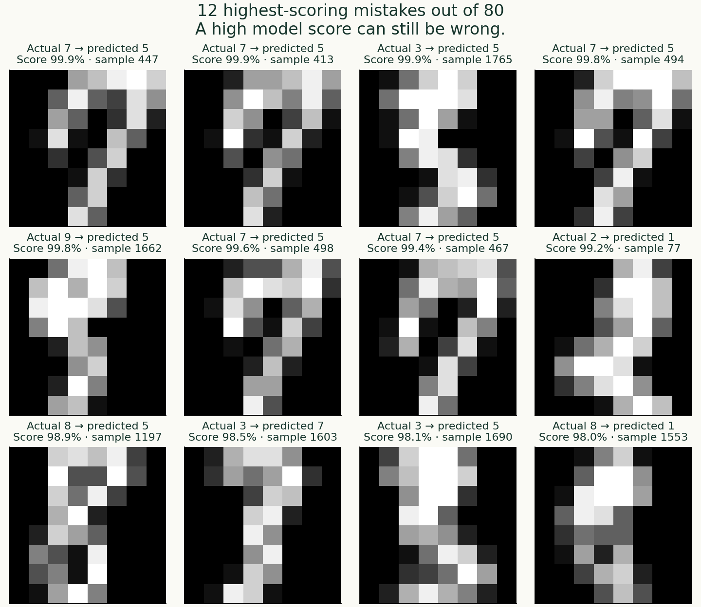
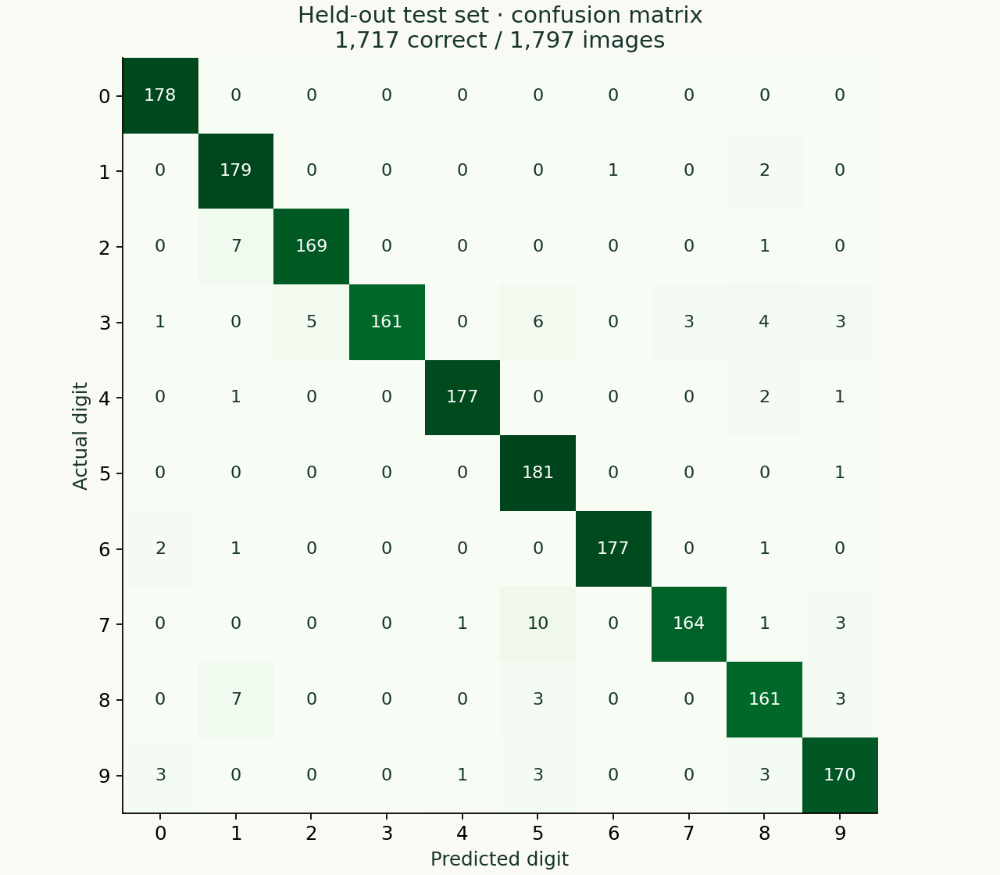
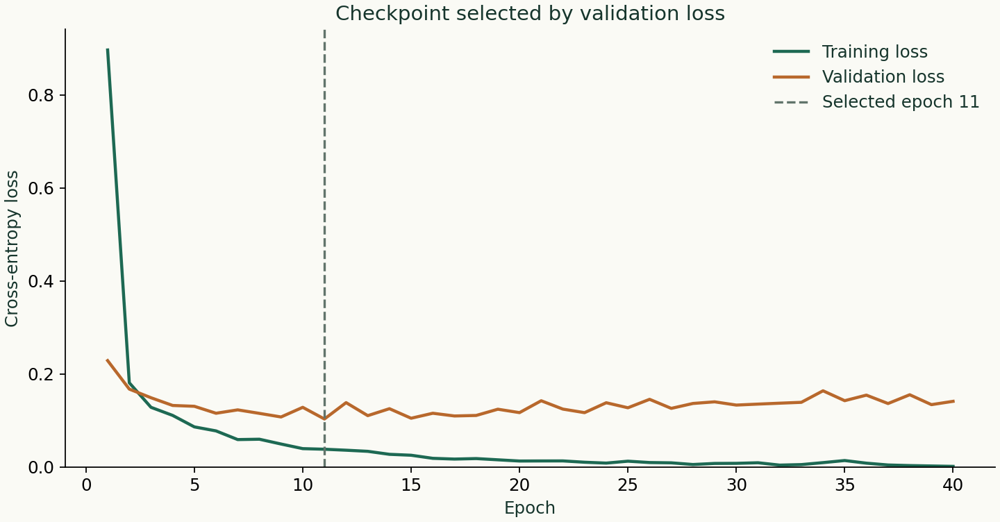

# PyTorch Digit Classifier

[](https://github.com/mustafaalazzawi1/pytorch-digit-classifier/actions/workflows/verify.yml)

A small image-classification experiment: train a **4,810-parameter PyTorch MLP** on 8×8 handwritten digits, compare it with logistic regression, and inspect its mistakes. The repository includes the original dataset files, trained JSON weights, every test prediction, and scripts to reproduce the results on a CPU.

[Explore the interactive results](https://mustafa-al-azzawi-portfolio.mustafaalazzawi.chatgpt.site/digit-classifier) · [Method and limitations](docs/METHOD.md) · [Interview notes](docs/INTERVIEW-NOTES.md)

## Recorded results

One fixed-seed run on 25 November 2026. Both models use the same 3,058 training images and fixed pixel scaling. Results are measured on the original 1,797-image UCI test set.

| Model | Test accuracy | Macro F1 | Correct / total |
| --- | ---: | ---: | ---: |
| PyTorch MLP | **95.55%** | **0.9554** | **1,717 / 1,797** |
| Logistic regression | 94.60% | 0.9461 | 1,700 / 1,797 |

The MLP made **80 errors**. Its 17 additional correct predictions are a result from this one run, not a claim of statistically established superiority. The checkpoint was selected at epoch 11 using the lowest validation loss across 40 epochs; test accuracy did not select the checkpoint.



The gallery shows the 12 highest-scoring mistakes, with ties ordered by test index. A softmax score is not a calibrated probability of being right. [All 1,797 predictions](artifacts/predictions.json) include the successful examples too.

## Run locally

Python 3.12 was used. From a fresh checkout:

```bash
python3 -m venv .venv
source .venv/bin/activate
python -m pip install torch==2.9.1 --index-url https://download.pytorch.org/whl/cpu
python -m pip install -r requirements.txt
python predict.py --sample 0
python verify_artifacts.py
python -m unittest discover -s tests -v
```

The CPU-wheel command is intended for Linux/Windows. On macOS, install the standard `torch==2.9.1` wheel with `python -m pip install -r requirements.txt`; the training script still uses the CPU. This project has been executed on Linux; a Mac run is not claimed.

Reproduce training in a **new** output directory:

```bash
python train.py --output runs/reproduction
python verify_artifacts.py --artifacts runs/reproduction
```

The script refuses to replace an existing run. Exact numerical reproducibility can depend on the recorded library versions and CPU runtime. [metrics.json](artifacts/metrics.json) records the environment, seed, split, epoch and checksums.

Optional figure generation requires Matplotlib, included in the requirements:

```bash
python make_figures.py
```

## How it works

- **Data:** original UCI training/test split; stratified validation comes only from the training file. UCI describes separate writers for its official train and test files.
- **Model:** flatten the already prepared 8×8 image → divide pixels by 16 → Linear(64, 64) → ReLU → Linear(64, 10). Cross-entropy loss and Adam, fixed learning rate 0.01 and batch size 64.
- **Selection:** 3,058 training images, 765 validation images, 1,797 untouched test images. Validation is image-level within the training file; writer IDs are not provided per row.
- **Baseline:** logistic regression with C=1.0 and the same training rows. Its settings were fixed before evaluating the test set.
- **Demo:** JavaScript evaluates the exported weights in the browser. It displays original prepared test images; it is not general-purpose OCR or an arbitrary-photo classifier.





## Verification

11 Python tests cover invalid inputs, dataset integrity, split isolation, JSON round trips, export validation, overwrite protection and result consistency. `verify_artifacts.py` recomputes both models’ test metrics and all saved predictions from their exported weights. `node tests/browser-parity.mjs` checks the browser implementation against PyTorch on all 1,797 test images (Node 22 or newer).

GitHub Actions runs these checks and a fresh fixed-seed training run with read-only repository permissions. The badge links to the actual run status.

## Scope and provenance

This is a small learning and portfolio project, not a production recognition service. It has one dataset and seed, no calibrated uncertainty, no cross-validation study and no real-world handwriting evaluation. Later experiments should use a fresh holdout when making decisions based on these published errors.

Prepared for **Mustafa Al Azzawi** with Codex assistance, following his choice of a simple PyTorch classifier with measured results and error analysis. The scripts and reported experiment were executed in the assistant’s Linux environment. This is a new project, not a republished university submission. Mustafa’s earlier computer-vision coursework is separate.

Data: Alpaydin, E. & Kaynak, C. (1998), *Optical Recognition of Handwritten Digits*, UCI Machine Learning Repository, [DOI: 10.24432/C50P49](https://doi.org/10.24432/C50P49), licensed [CC BY 4.0](https://creativecommons.org/licenses/by/4.0/). [Dataset provenance and transformations](data/README.md).

To serve the standalone results explorer locally, run `python -m http.server 8000` from the repository root and open `http://localhost:8000/web/`. It requires HTTP to load the JSON files; opening the HTML with a `file:` URL will not work. Inference runs in the browser with no backend or image upload.
